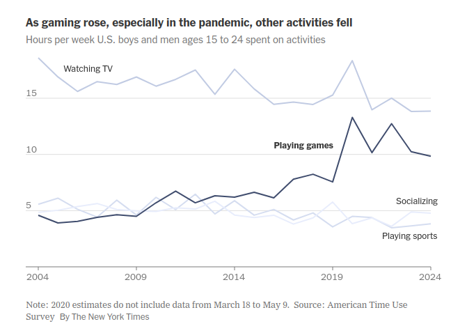
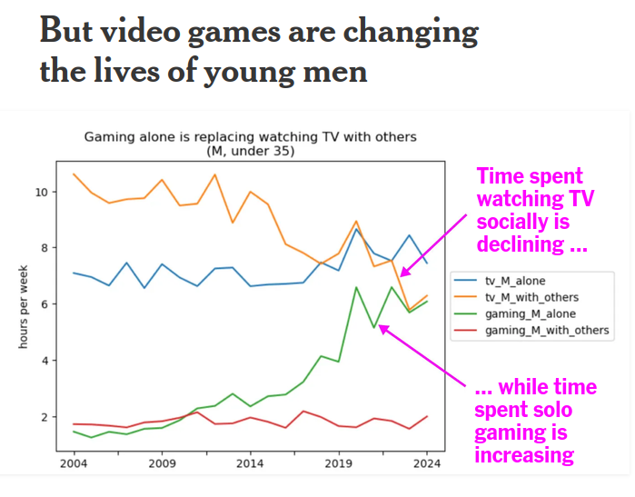

# American Time Use Survey, time spent alone.

Data analysis for _[How Video Games Are Shaping a Generation of Boys, for Better and Worse](https://www.nytimes.com/2025/10/03/upshot/video-games-boys-young-men.html), The New York Times. NOTE: This repository was cleaned up with the help of Claude Code (including writing parts of this README), but the original analyses and notebooks are hand coded. 



This repo uses two decades of the Bureau of Labor Statistics' **American Time Use Survey (ATUS)** to ask how Americans aged 15 to 29 spend their week. It compares 2004 with 2024 and asks what has replaced time once spent with other people.

Among men aged 15 to 24, weekly time spent **playing games** (ATUS code 120307, which includes video games) roughly doubled. It rose from about 4.6 hours a week in 2004 to about 9.8 hours in 2024. Over the same period, time spent watching TV and movies fell from about 18.6 to 13.9 hours a week, and time spent socializing and communicating fell from about 5.6 to 3.8 hours. The numbers come from `data/processed/nb_5_final_F.xlsx`, sheet `displacement_15-25` (ages 15–24; see [Outputs](#outputs)).

An version of this chart from an earlier analysis found that time spent gaming alone has replaced time spent watching television with others for men under the age of 35.



_from [11 Data Points and Discoveries That Stuck With Us in 2025](https://www.nytimes.com/interactive/2025/12/30/upshot/year-in-review.html)_

## Data

All source data is public and comes from the BLS: <https://www.bls.gov/tus/data.htm>

| File | Description | Used in final analysis? |
|---|---|---|
| `atussum-0324.zip` | Activity summary: one row per respondent, with demographics and final weights | ✅ |
| `atusact-0324.zip` | Activity file: one row per activity per respondent, with codes and durations | ✅ |
| `atuswgts-0324.zip` | 160 replicate weights per respondent, for standard errors | ✅ (`6_standard_errors.py`) |
| `atusresp-0324.zip` | Respondent file (`TRTALONE` and other respondent-level variables) | exploratory only |
| `atuswho-0324.zip` | Who file: who was present during each activity | exploratory only |
| `atusrost-0324.zip`, `atuscps-0324.zip` | Household roster; ATUS-CPS file | not used |

Data dictionaries and the activity lexicon:

- [Multi-year data dictionary / codebook](https://www.bls.gov/tus/data.htm)
- [Activity lexicon (2024)](https://www.bls.gov/tus/lexicons/lexiconwex2024.pdf)
- [How to use the microdata](https://www.bls.gov/tus/other-documentation/howto.htm)
- [Frequently used variables](https://www.bls.gov/tus/other-documentation/freqvariables.pdf) (also saved as `data/manual/freqvariables.xlsx`)

The data is not committed to this repo. The raw and processed files together come to about 2.4 GB.

## Repo structure

```
├── etl/
│   ├── 1_etl.py              # unzips the BLS .dat files and writes them out as parquet files
│   └── notebooks/1_etl.ipynb # scratch version of the above
├── analysis/
│   ├── 5_final.ipynb         # ← FINAL ANALYSIS: produces the published numbers
│   ├── 6_standard_errors.py  # SEs and confidence intervals for boys 15–24, 2004 vs. 2024
│   ├── 1_young people.ipynb  # exploratory (see below)
│   ├── 2_single_through_analysis.ipynb
│   ├── 3_redo_again.ipynb
│   └── 4_just_boys_video_games.ipynb
├── LineChart/                # Svelte component for the published line chart
│   ├── index.svelte          # the chart
│   ├── _data/                # chart data (hours/week, men 15–24, 2004–2024)
│   ├── _components/Axis/     # axis components
│   ├── _utils/               # label dodging and date parsing helpers
│   ├── DOC.aml               # ArchieML config for embedding the component
│   └── package.json          # d3 dependencies and component metadata
└── data/                     # git-ignored
    ├── source/{0324,2024}/   # BLS zip files go here
    ├── processed/{0324,2024}/ # parquet files written by the ETL
    ├── processed/            # analysis outputs (xlsx/csv)
    └── manual/               # reference material
```

## Reproducing the analysis

**Requirements:** Python 3.10+, `pandas` (2.x), `numpy`, `openpyxl` and `jupyter`. The exploratory notebooks also need `matplotlib`.

```bash
pip install pandas numpy openpyxl jupyter matplotlib
```

1. **Download** the 2003–2024 multi-year zip files from the BLS (`atusact-0324.zip`, `atussum-0324.zip`, etc.) into `data/source/0324/`. If you want the single-year files too, download `*-2024.zip` into `data/source/2024/`.
2. **Extract to parquet.** The script uses paths relative to `etl/`, so run it from there. The output folders have to exist first.
   ```bash
   mkdir -p data/processed/0324 data/processed/2024
   cd etl && python 1_etl.py
   ```
   This writes `data/processed/0324/atus{act,cps,resp,rost,sum,who}-0324.parquet`.
3. **Run** `analysis/5_final.ipynb` from top to bottom, from inside `analysis/`. 

### Outputs

`5_final.ipynb` writes `data/processed/nb_5_final_F.xlsx`, which has four sheets:

| Sheet | Contents |
|---|---|
| `displacement_15-25` | Average hours per week by activity category (see below), by sex, for each year 2004–2024. **Ages 15–24.** |
| `displacement_15-30` | Same, **ages 15–29**. |
| `above_0.5_hours_per_week_15-25` | Same estimate for every six-digit activity code (`TRCODEP`) averaging ≥ 0.5 hours/week in 2024, sorted by 2024/2004 ratio. Ages 15–24. |
| `above_0.5_hours_per_week_15-30` | Same, ages 15–29. |

## The graphic

The published chart is a Svelte component in `LineChart/`. It is built on a line chart template from the Times's internal Birdkit graphics framework, so it won't run on its own: it imports `$lib/shared/stores.js` (for dark mode) and expects Birdkit's CSV loader and fonts. The code is here to show how the chart was drawn.

- **Data.** `LineChart/_data/nb_5_final.xlsx - for_graphic.csv` holds 84 rows (`Year`, `Activity`, `Hours`): four activities for each year 2004–2024. The values are average hours per week for **boys and men aged 15–24**, taken from the `displacement_15-25` sheet of `nb_5_final_F.xlsx` (for example, playing games is 9.84 hours in 2024). The activities are relabeled for the chart: "Playing games", "Watching TV", "Socializing" (socializing and communicating) and "Playing sports" (sports, exercise and recreation).
- **Chart.** `index.svelte` draws one line per activity with `d3-scale` and `d3-shape`. The y-axis has ticks at 0, 5, 10 and 15 hours. Line labels are placed by hand, with "Playing games" in bold. `_utils/dodge.js` keeps labels from overlapping.
- **Dependencies.** `d3-array`, `d3-format`, `d3-scale` and `d3-shape` (versions in `LineChart/package.json`).

## Are the changes statistically significant?

`analysis/6_standard_errors.py` computes standard errors and 95% confidence intervals for the change from 2004 to 2024 among **boys and men aged 15–24**. It uses the 160 replicate weights BLS publishes for this purpose (`atuswgts-0324.zip`) and BLS's successive difference replication formula. The results are written to `data/processed/nb_6_standard_errors_boys_15-24.csv`.

Samples: 763 respondents in 2004 and 273 in 2024.

| Activity (hours/week) | 2004 (SE) | 2024 (SE) | Change | 95% CI | p |
|---|---|---|---|---|---|
| **Playing games** | 4.59 (0.49) | 9.84 (1.29) | **+5.25** | +2.5 to +8.0 | <0.001 |
| **Television and movies** | 18.59 (0.75) | 13.85 (1.15) | **−4.74** | −7.4 to −2.1 | 0.001 |
| **Sleeping** | 63.85 (0.77) | 67.56 (1.19) | **+3.70** | +0.8 to +6.6 | 0.01 |
| Socializing and communicating | 5.57 (0.51) | 3.83 (0.75) | −1.74 | −3.5 to +0.04 | 0.06 |
| Attending or hosting social events | 0.66 (0.14) | 0.37 (0.18) | −0.29 | −0.7 to +0.1 | 0.19 |
| Sports, exercise, recreation | 4.84 (0.41) | 4.78 (0.72) | −0.07 | −1.6 to +1.5 | 0.93 |
| All other activities | 69.89 (1.09) | 67.77 (2.36) | −2.12 | −7.5 to +3.3 | 0.44 |

The rise in games and the drop in TV are both clearly significant. The 95% interval for games puts the increase somewhere between about 2.5 and 8 hours a week. The drop in socializing is not quite significant at the 5% level (p = 0.06). With seven activities tested, p-values in the 0.01–0.06 range are weaker evidence than they look.

## Methodology

**Sample.** ATUS respondents aged 15–24 and 15–29, survey years 2004–2024. ATUS interviews one person per household about a single 24-hour day, from 4 a.m. to 4 a.m. Each year is a separate cross-section; the same people are not followed over time.

**Weights.** Estimates use the ATUS final weight `TUFNWGTP`. For 2020, they use `TU20FWGT`, the weight BLS provides for that year because data collection was interrupted by the pandemic.

**Durations.** `TUACTDUR24`, which is activity length in minutes, with the last activity cut off at 4 a.m. so that each diary sums to 1,440 minutes.

**Estimator.** For a group *g* (year × sex) and activity category *c*:

$$
\text{hours per week}_{g,c} = \frac{\sum_{i \in g} w_i \cdot \text{minutes}_{i,c}}{\sum_{i \in g} w_i} \times \frac{7}{60}
$$

The denominator includes every respondent in the group, so people who didn't do the activity count as zero. This is the BLS "average hours per day, civilian population" estimator converted to hours per week. As a check, the categories in each year × sex group add up to 168 hours per week.

**Activity categories** (`code_social_activities` in `5_final.ipynb`):

| Category | ATUS codes |
|---|---|
| Sleeping | `TRTIER2P` 0101 |
| Socializing and communicating | `TRTIER2P` 1201 |
| Attending or hosting social events | `TRTIER2P` 1202 |
| Television and movies | `TRCODEP` 120303, 120304 |
| Playing games | `TRCODEP` 120307 |
| Participating in sports, exercise, or recreation | `TRTIER2P` 1301 |
| All other activities | everything else, including work and school |

## Caveats

- **"Playing games" is broader than video games.** ATUS code 120307 covers video and computer games, and also cards, board games and puzzles. ATUS does not separate video games from other games.
- **2020 data.** BLS stopped collecting data from mid-March to mid-May 2020, so 2020 estimates aren't strictly comparable with other years.
- **Standard errors only for the headline group.** Standard errors are computed only for boys and men aged 15–24, 2004 vs. 2024 ([see above](#are-the-changes-statistically-significant)). Every other estimate in the output sheets is a point estimate. Groups such as 15–24-year-olds of one sex in a single year contain a few hundred respondents, and the year-to-year series is noisy.
- **Year-to-year changes in the endpoints.** The headline comparison uses two single years (2004 vs. 2024). The full series in the output sheets shows the trend in between.
- **Who-file changes.** This matters only for the exploratory "time alone" work. Since 2006, high school students have not been asked who was with them during class. Before 2010, nobody was asked who was with them at work. The exploratory notebooks leave work and school out of alone time for that reason.

## Exploratory notebooks

These notebooks are kept for transparency. **They are not the source of any published figure**.

1. `1_young people.ipynb`: first pass at weighted hours per week by activity code, sex, race and ethnicity for respondents under 35, plus time alone.
2. `2_single_through_analysis.ipynb`: time alone by age group, sex and birth cohort (using `TRTALONE`), and "social" activities done alone vs. with others.
3. `3_redo_again.ipynb`: rebuilds time alone from the who file (excluding work and class time), shows what share of people are alone at each time of day in 2004 vs. 2024, and compares gaming and TV alone vs. with others.
4. `4_just_boys_video_games.ipynb`: time spent playing games by age group and sex, and gaming alone by race, ethnicity, education, metro status, earnings and employment status.

## Credits

Analysis by Amy Fan. Thanks to the BLS ATUS staff for their guidance on the who file.